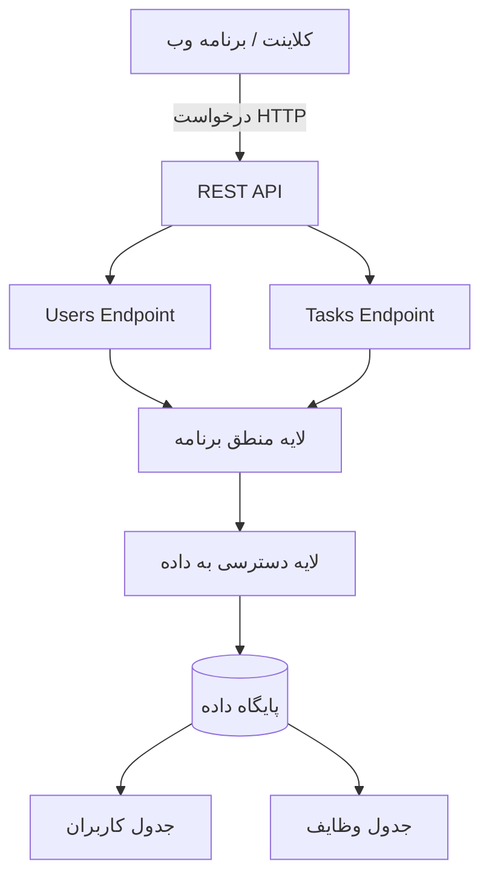

# طراحی REST API برای سیستم مدیریت وظایف (Task Management System)

## ۱. توضیحات پروژه

پروژه انتخاب‌شده، یک سیستم مدیریت وظایف (Task Management System) است. این سیستم به کاربران امکان می‌دهد حساب کاربری ایجاد کنند، وظایف خود را ثبت کنند، اطلاعات آن‌ها را ویرایش کنند و وظایف غیرضروری یا تکمیل‌شده را حذف کنند.

در این پروژه از معماری REST API برای برقراری ارتباط بین کلاینت و سرور استفاده می‌شود.

## ۲. انتخاب منابع پروژه (Resources)

این پروژه شامل دو منبع اصلی است:

- **Users (کاربران):** برای ذخیره و مدیریت اطلاعات کاربران.
- **Tasks (وظایف):** برای ذخیره و مدیریت وظایف متعلق به کاربران.

## ۳. طراحی Endpoint ها

### ۳.۱. منبع کاربران (Users)

| Endpoint | متد HTTP | کد وضعیت | توضیحات |
|---|---|---|---|
| `/api/users` | GET | 200 OK | دریافت لیست تمام کاربران |
| `/api/users/{id}` | GET | 200 OK | دریافت اطلاعات یک کاربر مشخص |
| `/api/users` | POST | 201 Created | ایجاد کاربر جدید |
| `/api/users/{id}` | PUT | 200 OK | ویرایش کامل اطلاعات کاربر |
| `/api/users/{id}` | PATCH | 200 OK | ویرایش بخشی از اطلاعات کاربر |
| `/api/users/{id}` | DELETE | 204 No Content | حذف یک کاربر |

### ۳.۲. منبع وظایف (Tasks)

| Endpoint | متد HTTP | کد وضعیت | توضیحات |
|---|---|---|---|
| `/api/tasks` | GET | 200 OK | دریافت لیست تمام وظایف |
| `/api/tasks/{id}` | GET | 200 OK | دریافت اطلاعات یک وظیفه مشخص |
| `/api/tasks` | POST | 201 Created | ایجاد وظیفه جدید |
| `/api/tasks/{id}` | PUT | 200 OK | ویرایش کامل اطلاعات وظیفه |
| `/api/tasks/{id}` | PATCH | 200 OK | ویرایش بخشی از اطلاعات وظیفه |
| `/api/tasks/{id}` | DELETE | 204 No Content | حذف یک وظیفه |
| `/api/users/{id}/tasks` | GET | 200 OK | دریافت تمام وظایف یک کاربر مشخص |

## ۴. کدهای وضعیت HTTP (Status Codes)

کدهای وضعیت زیر در این پروژه استفاده می‌شوند:

| کد وضعیت | مفهوم |
|---|---|
| 200 OK | درخواست با موفقیت انجام شده است. |
| 201 Created | منبع جدید با موفقیت ایجاد شده است. |
| 204 No Content | عملیات موفق بوده و محتوایی برگردانده نمی‌شود. |
| 400 Bad Request | درخواست دارای اطلاعات نامعتبر است. |
| 401 Unauthorized | کاربر احراز هویت نشده است. |
| 403 Forbidden | کاربر اجازه دسترسی به منبع را ندارد. |
| 404 Not Found | منبع موردنظر پیدا نشد. |
| 409 Conflict | بین اطلاعات درخواستی و اطلاعات موجود تداخل وجود دارد. |
| 500 Internal Server Error | خطای داخلی در سرور رخ داده است. |

## ۵. دیاگرام معماری پروژه (Architecture Diagram)

در این پروژه از معماری سه‌لایه (Three-Tier Architecture) استفاده می‌شود.

این معماری شامل سه لایه اصلی است:

۱. **لایه نمایش (Presentation Layer):** رابط کاربری که درخواست‌ها را به API ارسال می‌کند.

۲. **لایه منطق برنامه (Business Logic Layer):** مسئول پردازش درخواست‌ها، اعتبارسنجی اطلاعات و اجرای منطق برنامه است.

۳. **لایه داده (Data Layer):** وظیفه ذخیره‌سازی و بازیابی اطلاعات از پایگاه داده را بر عهده دارد.

### دیاگرام معماری (Mermaid)

## ۶. طراحی پایگاه داده (Database Design)

پایگاه داده این پروژه شامل دو جدول اصلی است.

### جدول کاربران (Users)

| نام فیلد | نوع داده | توضیحات |
|---|---|---|
| id | INT (Primary Key) | شناسه منحصربه‌فرد کاربر |
| name | VARCHAR | نام کاربر |
| email | VARCHAR | آدرس ایمیل کاربر |
| password | VARCHAR | رمز عبور هش‌شده کاربر |
| created_at | DATETIME | تاریخ ایجاد حساب کاربری |

### جدول وظایف (Tasks)

| نام فیلد | نوع داده | توضیحات |
|---|---|---|
| id | INT (Primary Key) | شناسه منحصربه‌فرد وظیفه |
| title | VARCHAR | عنوان وظیفه |
| description | TEXT | توضیحات وظیفه |
| status | VARCHAR | وضعیت وظیفه |
| user_id | INT (Foreign Key) | شناسه کاربری که وظیفه متعلق به اوست |
| created_at | DATETIME | تاریخ ایجاد وظیفه |

### رابطه بین جداول

رابطه بین جداول Users و Tasks از نوع یک به چند (One-to-Many) است.

- هر کاربر می‌تواند چندین وظیفه داشته باشد.
- هر وظیفه متعلق به یک کاربر است.
- فیلد `user_id` در جدول Tasks به فیلد `id` در جدول Users ارجاع می‌دهد.

## ۷. نتیجه‌گیری

در این پروژه یک سیستم مدیریت وظایف با استفاده از اصول REST API طراحی شد.

دو منبع اصلی Users و Tasks انتخاب شدند و عملیات اصلی CRUD برای هرکدام طراحی گردید. همچنین متدهای HTTP و کدهای وضعیت مناسب برای هر Endpoint مشخص شدند.

در نهایت، دیاگرام معماری سه‌لایه و ساختار اولیه پایگاه داده طراحی شد تا نحوه ارتباط اجزای مختلف سیستم با یکدیگر مشخص شود.

